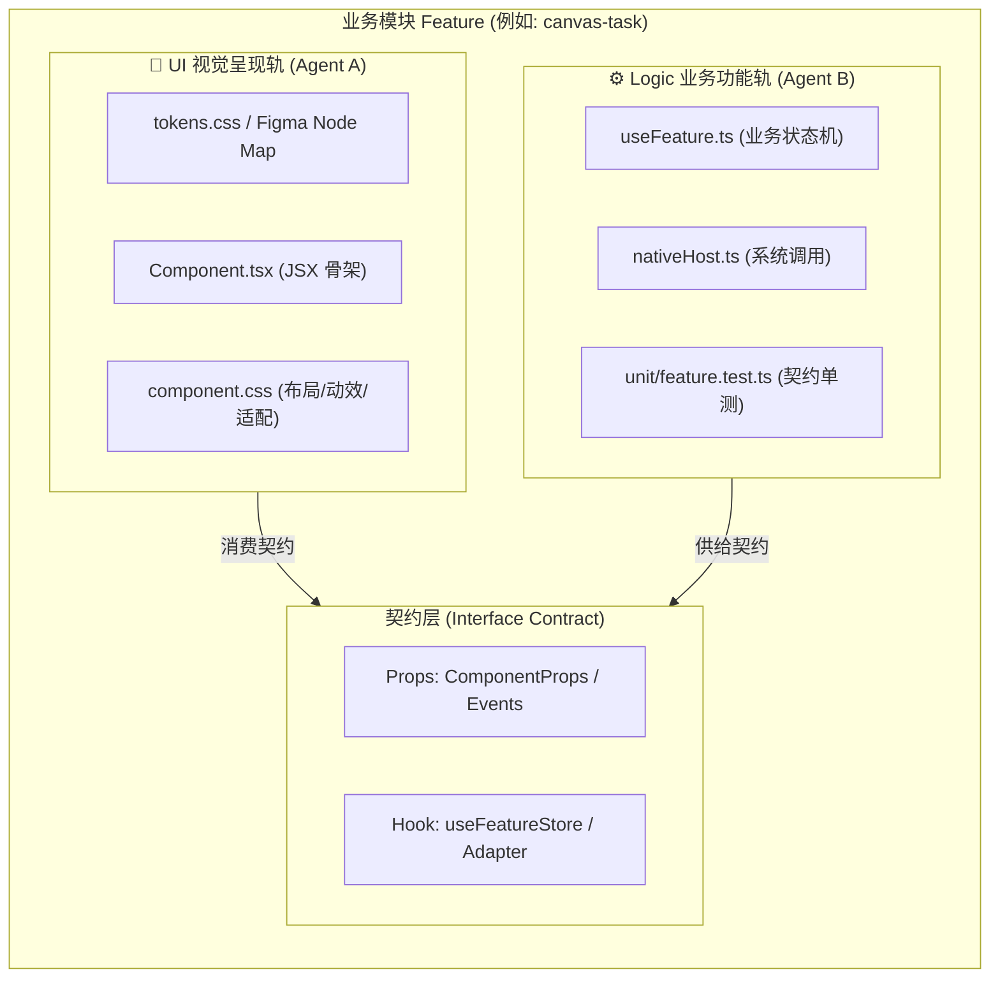
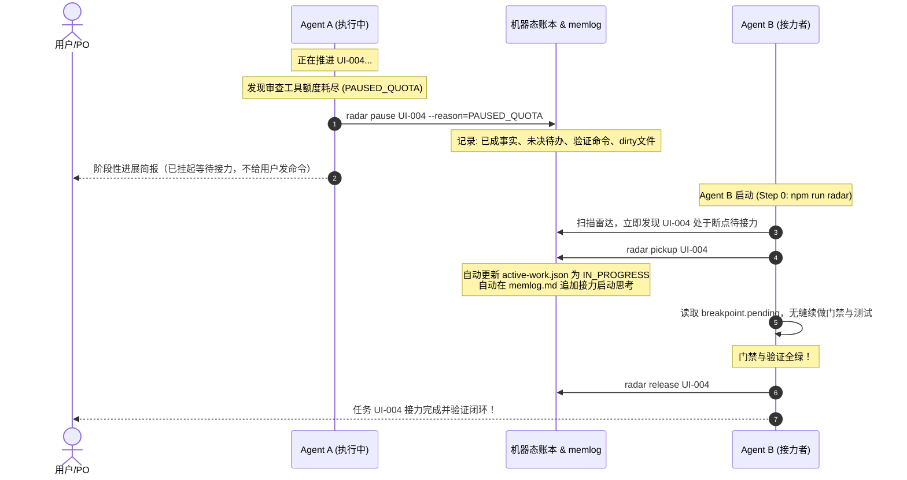

# AIG 蜂群自驱接力与双轨正交协同生态架构

> **目标愿景**：画布与画面 UI 是给人看的设计与体验空间，AI 之间的协作、信息交换、断点接力与并发攻坚必须是机器原生、高速低耗、全自动自驱运转的。用户（PO）作为产品总监与核心仲裁者，绝不承担终端命令执行或人工路由的低效体力活。

---

## 一、 核心痛点与 AIG 架构重构

```
旧模式（人工路由与互相阻塞）：
[用户/PO] <---- 堆砌 bash/git 命令 ---- [Agent A] （耗尽额度直接卡死，留下半截未测代码）
   |
   +---- 手动下发指令告诉 Agent B 接手 ----> [Agent B] （不知道先前做了啥，粗暴重来或冲突覆盖）
   |
   +---- 模块文件被粗暴独占锁死 ----> [Agent C] （即使只是给同一个组件写逻辑，也被迫停摆）

AIG 新生态（蜂群自驱接力与正交分轨）：
                      ┌────────────────────────────────────────┐
                      │  人类/PO 视角：产品方向仲裁、体验审查与验收  │
                      └───────────────────▲────────────────────┘
                                          │ 简洁交付/阶段汇报（零终端命令）
                      ┌───────────────────┴────────────────────┐
                      │    AIG 机器原生协同总线（毫秒级状态引擎）   │
                      │  docs/governance/active-work.json      │
                      │  docs/governance/ai-memory/memlog.md   │
                      └──────────────┬───────────────────▲─────┘
                                     │ 扫描雷达与断点池    │ 挂起与接力登记
           ┌─────────────────────────┴─────────┐         │
           │                                   │         │
  [Agent A: UI 呈现轨]              [Agent B: Logic 功能轨]  [Agent C: 空闲接力]
  • Figma Tokens 消费               • 自定义 Hook 业务逻辑       • 扫描到 PAUSED_QUOTA
  • CSS 样式与响应式布局             • 状态管理与数据验证         • 一键承接上下文
  • JSX 语义结构与图标              • IPC 与后端 Adapter        • 无缝推进最终门禁
  （同模块正交并行，零文件冲突）        （基于 Props 契约解耦）
```

---

## 二、 四大核心架构支柱

### 1. 去人工调度与终端禁令（`C-AUTO-04`）
- **核心铁律**：严禁向用户（PO）输出类似 `git checkout ...`、`npm run ...` 或 `请你在终端执行` 的任何命令。
- **全权自驱闭环**：一切代码编写、测试运行、Lint 门禁验证、工作树清理收敛、活跃锁声明与释放，全部由 Agent 自身调用工具链自主执行。
- **人机交互边界**：
  - **对人**：输出简洁高阶的进展汇报、关键架构取舍、以及需人工确认的 4 条红线（产品大方向转向、外部收费/GPL 协议依赖、破坏性数据迁移、生产发布外发）；
  - **对机**：通过结构化数据通道秒级同步。

### 2. 思维链留痕与机器高速态双向镜像（Dual-Trace Mechanism）
协作状态分为「上下文认知层」与「机器高速决策层」，保持 100% 强一致：

| 层次 | 载体文件 | 面向对象 | 读写特性 | 承载信息 |
| :--- | :--- | :--- | :--- | :--- |
| **认知留痕层** | `docs/governance/ai-memory/memlog.md` | 人类 PO / 大模型上下文 | 追加式（Append-Only）BMAD 思维链流 | 思考决策、改动事实、验证证据、交接意图 |
| **机器高速态** | `docs/governance/active-work.json` | Agent 运行时雷达脚本 | 毫秒级 JSON 读写与原子更新 | 任务 ID、分轨标签、负责人、状态机、断点与锁定文件 |

### 3. 同模块正交双轨并发（Dual-Track Orthogonal Concurrency）
解决传统粗暴锁住整个模块导致的停摆问题：



- **分轨规则**：
  - **UI 轨**：持有 `.css`、视觉 props、`UiIcon`、DOM 骨架、Figma Token；
  - **Logic 轨**：持有 `src/features/**/use*.ts`、状态 store、后端 API/IPC 适配器、数据测试用例；
- **正交判定算法**：
  - 若 Agent A 声明 `canvas-task` 的 `UI` 轨，Agent B 声明 `canvas-task` 的 `Logic` 轨 $\rightarrow$ **雷达裁定正交兼容，允许并行研发！**
  - 仅当两个 Agent 试图认领**同一模块的同一分轨**，或物理修改重叠的 dirty 文件时，雷达触发避让预警。

### 4. 额度/上下文断点挂起与全自动接力（Relay & Resume Engine）



---

## 三、 现行工具链命令接口（由 Agent 自动调用）

> [!NOTE]
> 以下命令统一封装在 `scripts/governance/agent-radar.mjs` 中，并已在 `package.json` 注册，**全部由 Agent 自身调用，无需人类敲命令**。

| 命令通道 | 内部执行命令 | 功能与机器行为 |
| :--- | :--- | :--- |
| `npm run radar` | `node scripts/governance/agent-radar.mjs status` | **全局协同态势感知**：展示最新交接、分轨活跃锁、待接力断点池、工作树脏文件以及正交双轨状态 |
| `npm run radar:pickup` | `node scripts/governance/agent-radar.mjs pickup [task-id]` | **全自动断点接力**：自动认领处于 `PAUSED_QUOTA` 或 `PAUSED_CONTEXT` 的断点任务，加载已成事实与待办，并留痕 `memlog.md` |
| `npm run radar:pause` | `node scripts/governance/agent-radar.mjs pause <task-id> ...` | **额度断点挂起保存**：将会话额度耗尽现场（dirty 文件、待办步骤、测试命令）结构化存盘 |
| `npm run radar prune` | `node scripts/governance/agent-radar.mjs prune` | **主干与分支收敛**：自动清理孤立 worktree，自动删除已合入 main 的陈旧分支 |

---

## 四、 本轮落地事实与验证

1. **AI 全权自治宪章落位**：
   - 在 [`KK-Studio-2.0/AI_RULES.md`](file:///D:/kk-studio/KK-Studio-2.0/AI_RULES.md) 新增硬约束：
     - `[C-AUTO-04] 禁向用户倾倒命令`
     - `[C-AUTO-05] 蜂群自驱接力与正交分轨（AIG Relay & Dual-Track）`
   - `node scripts/check-rules.mjs` $\rightarrow$ **52 rule IDs, 0 violations（全部通过）**。
2. **多 Agent 实时雷达与接力引擎完成重构**：
   - 升级 [`scripts/governance/agent-radar.mjs`](file:///D:/kk-studio/KK-Studio-2.0/scripts/governance/agent-radar.mjs) 支持 `claim`、`pause`、`pickup`、`release`、`status` 及正交双轨判定；
   - 接入结构化断点挂起，自动同步机器账本与追加 `memlog.md`；
   - ESLint 0 警告通过。
3. **真实接力验证（接手 Codex 额度耗尽任务 `UI-004`）**：
   - 成功执行 `radar pickup UI-004 Antigravity`；
   - 接管 Codex `/root` 因审查工具额度耗尽遗留的断点；
   - 验证 `UI-004` 所涉 `canvas-layout.spec.ts`（3/3 PASS）、`taskCostArchive.test.ts`（4/4 PASS）、Token 治理（1344 legacy, 0 regressions）、UI 标准（328 文件 0 违规），门禁全绿！
