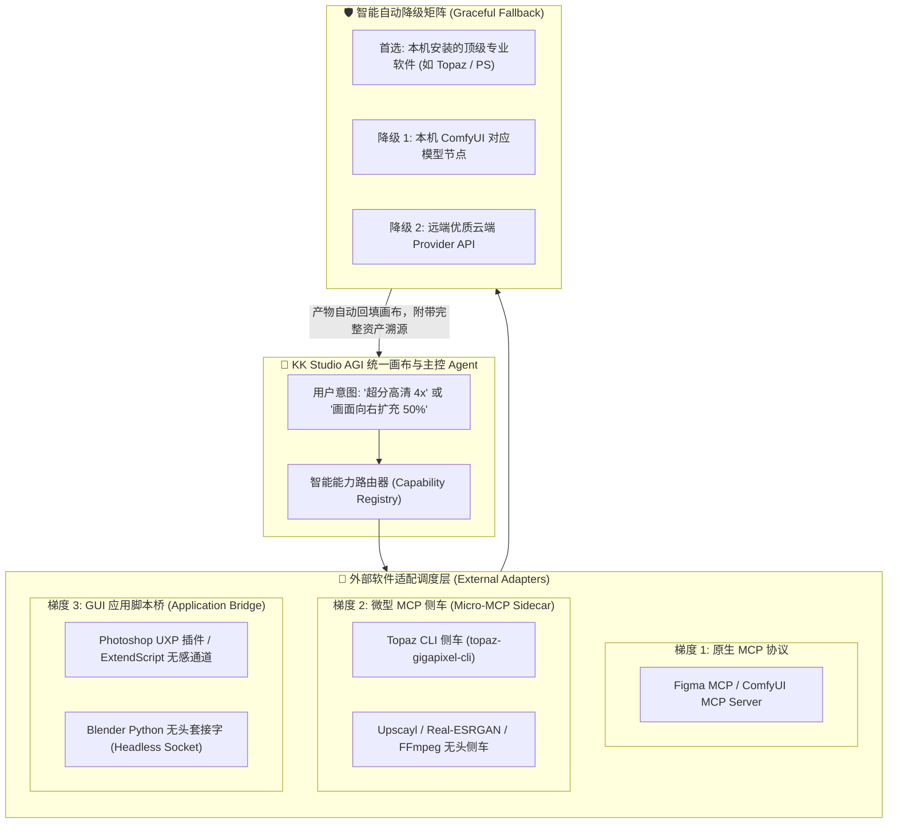

# KK Studio AGI 工作台 · 专业软件外部桥接与微型 MCP 侧车架构方案

> **核心原则**：KK Studio 的定位是 **AGI 统一协同大脑与无限画布**，而不是去重复造一个简易版 Photoshop 或 Topaz Gigapixel。对于市面上成熟、顶尖的外部专业软件，我们通过**「微型 MCP 侧车（Micro-MCP Sidecar）」**与**「无感后台调度（Headless Execution）」**将其收归为 KK Studio 的外部算力插件。用户在画布上只需表达意图，系统全自动静默完成调用与资产回填。

---

## 一、 为什么必须接入成熟软件？（认知与定位重塑）

在数字创意、分镜制作与影视资产生产中：
- **Photoshop**：在生成式扩图（Generative Expand）、精细选区笔刷、CMYK 印刷级色彩、图层智能对象上拥有数十年的工业沉淀；
- **Topaz Gigapixel / Photo AI**：在 4x/8x 极限超分、人脸面部微结构重构、噪点纹理修复上是全球公认的天花板；
- **ComfyUI**：在开源扩散模型（SDXL、FLUX、ControlNet、LoRA 串联）上生态最繁荣；
- **Blender**：在三维机位、白模构图、深度图提取上无可替代。

**结论**：KK Studio 不需要重复造轮子。用户只需在无限画布上点击或对 Agent 下达指令，背后的外部专业软件自动静默运转，产物自动回落画布。

---

## 二、 外部软件接入的三层梯度架构



### 1. 梯度 1：原生 MCP 服务（原生支持）
- 直接通过 KK Studio 现有的 [`src/features/mcp/mcpClient.ts`](file:///D:/kk-studio/KK-Studio-2.0/src/features/mcp/mcpClient.ts) 连接（Streamable HTTP 或 Stdio 进程通道）。
- 典型案例：Figma MCP、已具备 MCP 插件的 ComfyUI。

### 2. 梯度 2：微型 MCP 侧车（Micro-MCP Sidecar，解决没有 MCP 的软件）
- 对于提供命令行（CLI）或无头模式（Headless）的成熟软件（如 **Topaz Gigapixel AI**、**Upscayl**、**FFmpeg**）：
  - 我们编写一个极简的独立侧车脚本（~100 行 Node.js/Rust）；
  - 侧车对外暴露标准 MCP 工具（例如 `topaz_upscale({ inputPath, outputPath, scale: 4, model: "standard" })`）；
  - 侧车内部通过子进程静默拉起 `topaz-gigapixel-cli.exe`，监听进度，并在完成后将图片落地并通知 KK Studio；
  - **优势**：KK Studio 主程序代码 0 污染，完全解耦。

### 3. 梯度 3：GUI 应用自动化桥（解决纯图形软件）
- 对于纯 GUI 交互软件（如 **Adobe Photoshop**）：
  - 利用 Photoshop 官方的 **UXP（Unified Extensibility Platform）** 或 **ExtendScript** 在后台监听本地 WebSocket/HTTP 端口；
  - 当 Agent 发起扩图任务时，PS 在后台静默打开图像 $\rightarrow$ 执行生成式扩图（Generative Expand）$\rightarrow$ 导出无损 PNG $\rightarrow$ 发送完成信号；
  - 用户全程无需手动切窗口、抠图、另存为。

---

## 三、 智能降级矩阵（用户心智彻底解脱）

用户无需记忆任何底层软件的名字或命令行参数，在画布上只关注**创作结果**：

| 用户创作动作 | 首选专业软件（若本机检测到） | 自动降级 1（本机备用） | 自动降级 2（云端保底） |
| :--- | :--- | :--- | :--- |
| **超分高清 (Upscale)** | **Topaz Gigapixel AI** (CLI 侧车) | 本机 ComfyUI (`4x-UltraSharp` 节点) | 远端 AI 超分 API (Recraft / Cloud) |
| **生成式扩图 (Outpaint)** | **Adobe Photoshop** (Generative Fill 桥) | 本机 ComfyUI (`PadImage + Inpaint` 节点) | 远端 Inpaint API |
| **主体抠图 (Matting)** | 本地 **BRIA RMBG / BiRefNet** (轻量侧车) | 本机 ComfyUI 抠图节点 | 远端抠图 API |
| **3D 机位与白模 (3D Previz)** | **Blender** (无头 Python 渲染深度/线框) | 画布内置 3D 极坐标机位编译器 | 静态透视辅助网格 |
| **视频拆镜与抽帧 (Demuxing)** | 本地 **FFmpeg** 原生调用 | 浏览器内置 WebM/Canvas 解复用 | 服务端转码回填 |

> [!TIP]
> **软件自动探测机制**：桌面端（Tauri）启动时自动扫描 Windows 注册表与常见安装路径（如 `%PROGRAMFILES%\Topaz Labs LLC\`、`%PROGRAMFILES%\Adobe\Adobe Photoshop 2026`）。检测到即点亮对应的 Pro 能力徽标，未检测到则对用户透明隐藏并平滑走降级链路。

---

## 四、 极简微型 MCP 侧车实现模板（以 Topaz 为例）

以下是无 MCP 软件包装为标准 MCP 侧车的轻量结构（开箱即用，置于 `vendor/sidecars/topaz-mcp/`）：

```javascript
// vendor/sidecars/topaz-mcp/server.mjs
import { Server } from "@modelcontextprotocol/sdk/server/index.js";
import { StdioServerTransport } from "@modelcontextprotocol/sdk/server/stdio.js";
import { execFile } from "node:child_process";
import { promisify } from "node:util";

const execFileAsync = promisify(execFile);
const TOPAZ_BIN = "C:\\Program Files\\Topaz Labs LLC\\Topaz Gigapixel AI\\topaz-gigapixel-cli.exe";

const server = new Server({ name: "topaz-gigapixel-sidecar", version: "1.0.0" }, { capabilities: { tools: {} } });

server.setRequestHandler("tools/list", async () => ({
  tools: [{
    name: "topaz_upscale",
    description: "调用本机安装的 Topaz Gigapixel AI 执行顶级 AI 超分放大与面部重构",
    inputSchema: {
      type: "object",
      properties: {
        inputPath: { type: "string", description: "输入原图绝对路径" },
        outputPath: { type: "string", description: "输出目标绝对路径" },
        scale: { type: "number", enum: [2, 4, 8], default: 4 },
        model: { type: "string", enum: ["standard", "art", "recovery"], default: "standard" }
      },
      required: ["inputPath", "outputPath"]
    }
  }]
}));

server.setRequestHandler("tools/call", async (request) => {
  if (request.params.name === "topaz_upscale") {
    const { inputPath, outputPath, scale, model } = request.params.arguments;
    await execFileAsync(TOPAZ_BIN, ["-i", inputPath, "-o", outputPath, "-s", String(scale), "-m", model]);
    return { content: [{ type: "text", text: `Topaz 超分成功完成: ${outputPath}` }] };
  }
  throw new Error("Unknown tool");
});

const transport = new StdioServerTransport();
await server.connect(transport);
```

---

## 五、 结论与决策执行

1. **决策完全成立**：后续新增成熟外部软件，**统一走微型侧车（Micro-MCP Sidecar）或后台静默 CLI/脚本桥**，绝不把庞杂的三方代码侵入到主工程中；
2. **全权代理为您兜底**：您完全不需要学习这些软件的 CLI 参数或 IPC 协议；在 KK Studio 界面上，您只看得到直观的「超分」、「扩图」、「重绘」按钮，底层的软件选择、故障转移与降级由系统全权自驱完成。
