# UI 与交互专项思维链（UI & Motion Thought-Chain）

> 领域：UI 视觉呈现、组件设计、Figma 真值同步、动画微交互、按钮行为映射
> 适用：当用户需求涉及页面、按钮、弹窗、动效、样式调整时，AI **自动且仅**加载此文件。

---

## [2026-11-06T11:04:54.001Z] UI-004 MCP当前回执（非全量完成）
- Codex：MCP-only视觉修正26定向PASS，typecheck/UI/Token/规则/build通过；Figma源437:64052说明先改并回读，字体/三封面/hero原SVG已按9:3落本地，真实CDP确认loaded。
- Desktop：第二轮官方helper退出0，2.1.66 EXE659e1eb4141f / inputf2d7addff220，source HEAD3d7cc573+dirty，构建前后源码指纹一致、依赖一致、四项dist资产hash一致。首轮来源漂移被拒，失配收据另存output，不能复用。
- 当前：UI-004为PARTIAL；全页/六态/像素、字体修改后整套verify、Native窗口与正式独审/发布未验。原127项目保护保持，没有清空/覆盖数据。下一步严格逐页同状态MCP对照，先改Figma缺陷再同步本地，不用快速门禁冒充100%。

## [2026-11-06T11:02:04.833Z] UI-004 MCP-only视觉纠偏与证据边界
- Agent：Codex /root；用户最新要求：所有操作通过MCP，Figma问题先在Figma修复并回读再改本地。不要继续以快速门禁代替视觉还原，不擅自标100%。
- Figma：01规则与9:3/47:185重新回读；437:64052中关闭32/20说明已通过MCP改为实际32/16，组件和下游几何保持。
- 本地：官网Source Han Sans CN VF原文件已入public/fonts并按既有font token加载，三封面使用当前Figma城市/香水/演出（城市原文件字节相同复用），hero655:140742同步当前64原SVG。DOM投影fonts为空不等于未加载；真实CDP已确认loaded。
- 浏览器：旧标签仍停留旧内容，新建同源标签已验证新资源和字体，旧空草稿标签关闭；保留http://127.0.0.1:1421/?figma-sync=20261106。原数据读取保护仍在，没有清空或覆盖。
- 验证：本批26定向生产浏览器、typecheck/ui:check/rules:check/build通过。完整verify24的旧959通过只绑定当时来源；后续format失败、MCP浏览器环境失败均保留。Pixel仍没有Figma基线，不可宣布全量完成。
- Desktop：第一轮MCP编译完成但delegationPipeline在构建中被其他agent修改，源码指纹FAIL；失配收据移到output保留，第二轮官方helper重新构建核验。独审额度失败未补齐，UI-004为PARTIAL。

## 1. UI 治理铁律（用户核心诉求）

1. **所见即所得，用户唯一视觉窗口**：
   用户最能直接看懂的是 UI 视觉，因此 UI 变动必须保证与 Figma 设计真值严格对齐，不私自发明样式。
2. **按钮行为“主动三问”原则**：
   用户清楚视觉与交互体验，但按钮底层挂载什么具体后端接口或状态机可能不清楚。
   **AI 严禁私自瞎挂行为或编造假逻辑，必须主动以单选/结构化形式向用户提问**：
   - ① 该按钮触发后是直接本地响应（如弹窗/切换状态），还是调用后端异步任务？
   - ② 执行中的 Loading / 禁用态是什么视觉表现？
   - ③ 失败或超时后的兜底反馈（Toast / 红色错误态）由哪个组件承载？
3. **极简代码，拒绝臃肿（Anti-Bloat）**：
   - 严禁为了一个小按钮封装多层无关的抽象层。
   - 优先复用 `src/components/ui/` 已有的标准原子组件（Button, Dialog, Tooltip 等）。
   - 禁止顺手改动非当前组件的其他页面样式（恪守 `RULE-NO-DRIVEBY`）。
4. **零临时文件残留（Zero Residue）**：
   - 调试过程中的临时截图、HTML 预览、测试日志一律写进 `.tmp/`，任务结束验证完毕必须清理，严禁散落在源码或文档目录。

---

## 2. 现行 UI 关键事实与设计真值

- **唯一 Figma 真值文件**：`ZiadpErDoFweCjG3uHjkM3`（节点：`91:2`/`91:4`/`91:3`/`2:47`/`91:11`）。
- **设计令牌管线**：`src/styles/tokens.css` 为三层令牌（全局引用 $\rightarrow$ 语义语义层 $\rightarrow$ 组件层）。
- **组件目录落点**：`src/components/`，按业务切片内聚；公共原子组件在 `src/components/ui/`。

---

## 3. UI 专项思维与决策流（最新记录追加于此）

### [2026-11-05 23:45] UI 治理与按钮行为映射框架建立
- **执行 Agent**：Antigravity (Gemini 3.8 Flash High)
- **核心决策**：
  建立 UI 专用思维链，与底层引擎、构建脚本解耦。AI 接到 UI 需求时，自动只看此文件。
- **按钮功能治理方案**：
  后续凡是添加或重构 UI 按钮，AI 必须主动在设计时列出《按钮功能清单》，说明按钮名称、预期视觉图标、底层触发事件与异常表现，向用户简明确认后再编码。
- **待办**：后续遇到具体页面重构时，在此按任务追加视觉与按钮行为的思考留痕。

---

## 4. 双轨并行与上下文防断层法则（跨 Agent 协同铁律）

1. **AI 绘图先行（Figma Co-Design & PO Review Gate）**：
   开发过程中如需新增或重构 UI 界面，**AI 绝不能在本地代码中凭空编写 CSS/JSX，必须先到 Figma 目标画板中，严格按照 L0~L5 规则搭建出组件/页面原型**；在组件 Description 留下白话功能说明；由用户（PO）在 Figma 中进行视觉审查确认后，才允许同步生成本地代码！
2. **Figma L0~L5 继承体系（权威真值来自 Figma 3096:368）**：
   - **L0 (变量)**：引用 01 变量，严禁散落硬编码；
   - **L1 (原子)**：02 统一图标源 + 文本字阶 + 共用底板；
   - **L2 (控件)**：按钮等基础控件遵循五档框（16/24/32/40/44）与标准变体；
   - **L3 (组合)**：卡片、输入栏由 L2 控件组装；
   - **L4 (容器)**：Auto-Layout（HUG/FILL/Min/Max）自适应；
   - **L5 (页面)**：04 桌面 / 05 手机只决定数据与状态，仅消费实例，禁止手搓散装母版。
3. **双轨解耦并行（Dual-Track）**：
   - **UI 呈现轨**：AI 读 Figma 节点 $\rightarrow$ 提炼 Tokens $\rightarrow$ 编写纯呈现组件（TSX + CSS，打上 `data-figma-node`，暴露事件回调与状态 Props，如 `onSubmit`, `isLoading`）。
   - **功能业务轨**：另一个 Agent 同步在 `src/features/` 或 `src/domain/` 编写接口适配器、模型请求或领域逻辑，输出纯业务 Hook。
   - **组装合流**：在页面容器层将 Logic Hook 注入 UI Props。两边并行开发，互不阻塞！
4. **上下文掉落防御（Zero Context Loss）**：
   无论何时新起会话、换新平台或上下文中断，AI 必须自动：
   - 查阅 `ui-motion.md` 最新的任务记录；
   - 查阅 `design/figma-component-map.json` 获取当前组件绑定的 Figma 节点；
   - 通过组件的 `data-figma-node` 属性，直接用 Figma MCP 回读最新视觉与 Description，瞬时无缝接力。

## [2026-11-06 01:39] Figma 规则先行的最小修整
- 01 规则补齐页面职责、去重复卡片、设置/表单层级、SVG 光学校正、悬挂标点与可打断动效；先规则、后改源与页面。
- 03 共享源 `1189:20259`、`214:703`、`1189:20199/20210/20221`、`1092:18030/18112/18181`、`4204:52618/52654/52690` 已变更；本地同步与受影响映射仍待逐项处理。
- 04 去 28 个内容壳；05 去窄网页 3 壳、整理 38 个可见手机设置组及两份连接表单。两个原有隐藏高级组保留，不扩大当前验收范围。
- 静态回读与列明截图通过；12 个导航/覆盖层过渡保留原动作与目标。180ms 入场 ease-out、150ms 已有整页关闭 ease-in；运行时打断/reduced-motion 未验证。
- 详细记录：`D:/kk-studio/docs/05-references/audits-archive/2026-11-06-figma-creative-focus-minimal-repairs.md`。未修改本地产品代码，整体跨端交互验收为 PARTIAL。

---

## 5. 组件库 Token 治理法则（Tier 3 Component Tokens）

> 为彻底杜绝代码臃肿、写死样式与改动崩塌，所有组件库（03 / 00B）必须严格实行「三层令牌驱动」与「机械映射」。

### 5.1 三层 Token 架构分工
1. **Tier 1 原始层（Primitive）**：纯数值无语义（如 `--kk-dark-1: #161616`、`--kk-space-4: 16px`）。**业务组件与页面严禁直接消费**。
2. **Tier 2 语义层（Semantic）**：承载业务含义与主题切换（如 `--kk-bg-surface`、`--kk-text-primary`、`--kk-button-primary-bg`）。通过 `[data-theme="light|dark"]` 动态切换数值。
3. **Tier 3 组件层（Component Token）**：**组件专属命名令牌**（如 `--kk-button-h-sm`、`--kk-button-primary-bg-hover`、`--kk-choice-selected-bg`）。
   - **零硬编码铁律**：Tier 3 令牌内部只允许使用 `var()` 引用低层令牌，严禁出现任何原始 Hex 颜色或裸 `px` 字面量！
   - **单向解耦**：PO 在 Figma 调整圆角、间距或主色时，只刷新 Token 映射值，业务代码与组件结构无需做任何改动，杜绝回归风险。

### 5.2 命名与状态机械转换律（D-TOKEN-03 / D-TOKEN-04）
- **机械转换公式**：Figma 变量路径去掉首段集合名，`/` 替换为 `-`，前缀统一加上 `--kk-`。
  - 例：Figma 变量 `component/button/primary/bg/hover` ⇄ CSS `--kk-button-primary-bg-hover`。
  - 核心转换由 `scripts/design-tokens/naming.mjs` 自动实现，**严禁任何 Agent 人工造词或起别名**。
- **法定状态后缀**：仅允许使用 6+3 种法定后缀：
  - 交互态：`default`（省略）、`hover`、`active`、`selected`、`disabled`、`focus`；
  - 业务态：`loading`、`error`、`success`。

### 5.3 组件 Token 化完成定义（DoD）
任何共享组件（如 Button, Input, Modal, Tab, Drawer 等）只有达成以下 5 项指标，才能在 `design/figma-component-map.json` 中标为 `SYNCED`：
1. **映射表登记**：在 `design/figma-component-map.json` 登记稳定 ID、Figma `nodeId`、本地组件路径与 Token 前缀；
2. **专属 Token 族**：拥有自己独立的 Tier 3 Token 块，全为 `var(--kk-*)`；
3. **零裸样式**：TSX 与 CSS 中绝无内联硬编码（颜色、尺寸、阴影、圆角、动效）；
4. **属性 1:1 映射**：Figma 变体属性 ⇄ React Props ⇄ DOM `data-*` 属性同名对应（如 `size="sm"` ⇄ `data-size="sm"`）；
5. **门禁全绿**：通过 `npm run tokens:check` 与 `npm run ui:check`，无任何违规与回归。

---

## 6. Figma 五页角色与推进优先级契约（PO 确立）

为避免因页面高频调整导致代码反复重写、堆积冗余垃圾，确立以下自底向上的工程推进优先级：

```mermaid
flowchart TD
    P1["01 · 设计规范 (规则源)"] -->|固化规范与约束| P2["02 图标与品牌 + 03 组件与交互 (坚固底座)"]
    P2 -->|Token 100% 对齐 & 零硬编码| P3["04 桌面页面 + 05 手机页面 (展现与业务)"]

    style P1 fill:#1a233a,stroke:#3b82f6,stroke-width:2px
    style P2 fill:#14342b,stroke:#10b981,stroke-width:2px
    style P3 fill:#312e1e,stroke:#f59e0b,stroke-width:1px,stroke-dasharray: 5 5
```

1. **第一优先级 · 01 规则系统对齐**：
   - Figma `91:2` 是权威设计规则源，直接对齐本地规则文档：`RULES.md`、`AGENTS.md`、`DESIGN.md`、`DESIGN_TOKENS.md`、`UI_INDEX.md`。
   - 规则核心：L0~L5 体系规范、KFS 门禁、按钮五档框（16/24/32/40/44）、微明度三阶跃、动效时序（120/150/180/220/260ms）。
2. **第二优先级（当前攻坚重心）· 02 图标与 03 基础组件 Token 对齐**：
   - **02 图标与品牌 (`91:4`)**：全量 124 项原子图标、9 类功能语义、12/16/20/24 尺寸轴、描边权重（0.75/1/1.25/1.5）、IconSlot 命中区（44 触控/24 独立工具/16 控件内嵌）。在本地由 `UiIcon.tsx` 与 `--kk-icon-*` 承接。
   - **03 组件与交互 (`91:3`)**：操作按钮、图标按钮、单行输入、页签（Tabs）、分段选择器（Choice Group）、开关、复选框、菜单底板等基础原子控件。变动极小、底座最稳。
   - **目标**：在 `tokens.css` 中建齐专属 Tier 3 Token，在 `design/figma-component-map.json` 中全量绑定。
3. **第三优先级（后续装配）· 04 桌面与 05 手机页面**：
   - 属于具体业务流与场景展现，目前处于 PO 活跃推敲与体验优化期，变动频繁。
   - **现阶段策略**：**严禁任何 Agent 盲目大动 04/05 页面代码**，杜绝产生僵尸代码；等 01 规则、02 图标、03 组件的 Token 和底层逻辑完全锁死并验收通过后，再在页面层直接调用组件进行像“拼积木”一样的高效组装。

## [2026-11-06 02:21] 04 卡片与重复展示行接入03共享源
- **执行 Agent**：Codex
- **完成范围**：通过 Figma MCP 修复29个重复单元：Featured 4、Installed 2、首页灵感9、伙伴角色7、Agent展示行7。既有卡片族621:4096保留20个旧变体、补7个必要布局/状态，另建1个只读Agent行源。29个原页面根ID保留，每个包装只含完整03实例；22处本来已有完整实例的布局包装保留。
- **证据**：22张卡片177节点的内容/几何/字体/图片/动作比较保持；7条Agent行70节点内容与样式保持，内部自然排版有小于1px非文本几何差异与1–8px字形包围盒差异。8种源实际改间距再恢复，页面继承8/8通过。最终29/29结构检查无列明失败，rules:check为50 IDs / 0 violations。
- **规则与边界**：遵循既有2000:277，无新增规则；按现行禁渐变要求将Installed占位封面改为现有surface-container-high纯色。未改图片、业务内容或原动作。未同步本地代码/token/映射，未接管已有dirty diff，未验收04全部控件/05/运行交互/全部断点与正式独立审查。
- **定位**：Figma复核区4493:65152；审计D:/kk-studio/docs/05-references/audits-archive/2026-11-06-figma-04-card-component-inheritance.md；原始记录D:/kk-studio/output/figma-card-inheritance-2026-11-06/。

## [2026-11-06] Figma 04 母版复用与 05 图标来源修复
- Agent：Codex；仅 Figma，fileKey ZiadpErDoFweCjG3uHjkM3，session 34307991-f0f1-4824-af9f-d58bb1dd7aa6。
- 手机：3 处文字加号换为 02 加号实例，4259:14057 增加数量误用减号改为公开图标属性 372:1168；默认/悬停/按下均保留加号和 44px 命中区。最终 1010 个图标/品牌实例均来自 02 现行库，无私有矢量、文字假图标或路径覆盖。
- 04：223 个不同主要实例接回 03（224 条记录含 1 处搜索分步重合）；涵盖字段、ComfyUI 参数、视频卡片、键帽、状态标签、筛选、多行输入及重复完整组合。新增有效来源 16 个，旧变体 ID 保留，来源 description 已登记。
- 验证：223 实例/27 来源间距继承探针通过且值/绑定恢复；04 全范围 16880 实例无失联/非现行来源；9 个桌面和 4 个手机代表场景视觉复核；规则检查 50 IDs/0 violations。发现并修复 API 标题/说明误绑定、评论最小高度和短键帽最小宽度问题。
- 规则 2000:277 已覆盖唯一来源，无需另加规则。未修改产品代码、Token/映射表或执行运行、完整原型、全页面视觉/动效验收；新增用途/组合本地同步仍未验证。
- 审计：D:/kk-studio/docs/05-references/audits-archive/2026-11-06-figma-04-full-components-and-mobile-icons.md；证据：output/figma-04-full-inheritance-2026-11-06/ 与 output/figma-mobile-icons-02-2026-11-06/。
